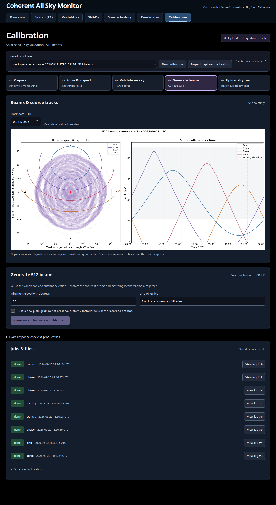

# Calibration workspace

Implemented September 22 and restyled September 25, 2026 at `/cal` on 8061.
The five steps use larger controls, green antenna selections, white phase/transit
figures, a compact plot gallery and the shared click-to-zoom viewer. Existing
results come before collapsed settings; jobs and downloadable files remain saved.
Historical PNGs retain their original pixels; newly rendered diagnostics use
the white style. The old Commissioning page is superseded.
October 1 controls use gray for untouched steps (including the selected step),
amber for running work, green for reviewed preparation or saved outputs, and
red for a failed or cancelled job. `/cal` starts a fresh, unreviewed preparation;
it no longer restores a candidate from browser storage. Select a saved candidate
or open `/cal/{tag}` explicitly to see its saved progress. **New calibration**
also clears review/completion state. Opening a step does not complete it. An imported reference does
not count as a new solve/grid; green sky validation means a saved independent
transit to review, not scientific acceptance. Export & deploy turns green after
local payload checks pass and says **not uploaded** until a successful upload
receipt exists. Transfer success still requires separate runtime verification.
The Prepare header has large **Current deployed calibration** cards for the
calibrator/observation date, solve window and last upload date/time. OVRO local
is the default, with a UTC toggle. These follow the ledger's bound report and
stay fixed when a trial date changes; missing metadata is labelled unavailable.
From Solve & inspect onward, a persistent bottom bar provides **Proceed to…**
and **Back to…** controls. It shows the selected subtraction mode and antenna
count, and returns the view/focus to the next step's heading. Navigation retains
the selected revision and transit inputs; it does not submit a job or mark a
step complete. Forward navigation is disabled until the calibration is saved.

[Phase views](screenshots/2026-09-25-calibration/phase.png) ·
[Stationary-transit views](screenshots/2026-09-25-calibration/transit.png)

## Operator flow

1. **Prepare**: choose the solar date and up-to-four-hour solve/static windows,
   antenna membership, reference and hardware-epoch note. Initial date and windows
   come from the last uploaded calibration's bound canonical report, selected
   through the deployment ledger, never from the latest generated candidate.
   The explicit no-static choice is preserved. **New calibration** restores
   these recorded starting values without selecting/completing a saved build.
   Changing to another date computes windows for that day. If the uploaded
   recipe cannot be identified, a labelled fallback uses the day before the
   newest raw filename (or yesterday) and computed/configured windows. No path
   guesses or report modification times establish an uploaded recipe.
   Current layout bytes and the privately adjusted inclusion flags
   are saved separately. A new scientific selection requires a new tag.
   Solve and static time entry default to **OVRO local (America/Los_Angeles)**;
   the UTC toggle changes display only, preserving the selected instants.
   The Sun altitude maximum shows its altitude and both dated local/UTC times.
   The solar date is the Sun-maximum date, the same civil day in UTC and at OVRO;
   the matched static window can fall on the previous local evening. Recipes
   and API timestamps remain UTC. Invalid or repeated DST-hour edits block
   submission; choose UTC explicitly for either occurrence of a repeated hour.
   Antennas default to the recorded deployed CB weights, not the layout flags.
   On October 1 the selection matched the SNAPs deployment view's 16 antennas;
   antennas 12 and 33 were layout-only and unselected. This was a saved-product
   comparison, not a fresh GPU readback. Missing deployed weights retain the
   existing labelled layout fallback.
   **Choose a static window** plots the Sun, Cyg A, Cas A and Tau A for exactly
   the selected local date, 00:00 through 23:59 PT (24 hours normally, 23/25 on
   DST transition days). Altitude runs from 0° to 90°; a horizontal 20° line
   marks the gray low-altitude region. Negative altitudes remain available to
   the window finder but are clipped from the plot, not moved onto the horizon.
   This display shading does not change the per-source quiet-window cuts.
   It follows the same local/UTC toggle without changing the date's physical
   bounds and supports zoom/download. Yellow is the **selected solar solve
   window**, not a separate transit marker. A dashed green, 14%-opacity band
   shows a **suggested 30-minute static window**; blue is the selected static.
   The suggestion considers every full 30-minute window on that local day,
   endpoints included. Prefer Sun altitude ≤ −10° throughout. Among dark windows,
   minimise the maximum above-horizon altitude in strict Cyg A, Cas A, Tau A
   order. Set sources tie at zero; exact ties choose the earliest window.
   If none is dark, choose the lowest solar altitude and warn while allowing
   the operator to proceed. Within dark windows, Sun depth is not optimised further. This operator-requested
   priority is not a flux or beam-contamination model. The card shows each
   source's maximum altitude and warns if usual caps are exceeded; it never
   calls a ranked compromise a verified quiet template. **Use suggested window**
   fills the form and clears review, without submitting a job or replacing the
   uploaded defaults automatically.
   Under **Fixed altitude-cut windows**, the canonical
   `casm_vis_analysis.offsource.find_quiet_windows` supplies intervals of at
   least 15 minutes using `DEFAULT_ALTITUDE_CAPS_OVRO`: Sun/Tau A below 0°,
   Cyg A below 20°, Cas A below 15°. Cas A never fully sets at OVRO.
   Its **Use 30 min** button (or a shorter qualifying duration) fills a centred
   interval and clears human review; it does not start a job or silently replace
   defaults. If no interval qualifies, the page says so. Altitude warnings are
   advisory: RFI, missing data and hardware compatibility still need checking.
   Source tracks, ranking and cuts are sampled each minute; these are geometric
   altitudes, not a terrain horizon or a visibility-data quality measurement.
2. **Calibrate**: the canonical `make_cal_and_weights` driver runs with
   `make_weights=False`, phase-only per-channel SVD, diagnostics and notebook.
   No grid, upload or live layout edit occurs. A failed job retains its log.
3. **Solve & inspect**: the October 1 array inspector provides Compact antenna
   order, SNAP order and Station grid, with white figures, wiring labels,
   shared zoom/download and selectable display reference. Autos, crosses,
   antenna weights, rank-1 quality and cross-day validation are scrolling
   sections. Native-channel spectra and all unique cross-baselines are saved
   once per inspection; display changes do not reread raw data or rerun SVD.
   October 2 replaces diagnostic dropdowns with visible button groups for
   layout, processing, quantity, plot type, amplitude scheme and weight view.
   Reference antenna and clock remain dropdowns. Autos have independently
   selectable **Raw**, **Static template** and **Static-subtracted** buttons,
   also available inside zoom. Raw and subtracted start selected in separate
   plots, each with its own fitted y-axis. **Overlay** is optional and uses a
   common y-axis per antenna. With no saved template only Raw is available.
   Selecting none shows an explicit empty state.

   **Without subtraction / With subtraction / Compare** (October 5) switches
   saved calibration solutions within one comparison family. **Prepare** queues
   the missing solution through the canonical driver, with the same source
   window, antennas, reference and frozen layout. Older candidates need this
   one-time solve; browsing alone does not start it. The original request and
   products stay unchanged. Each solution has its own diagnostics, validation,
   beam products and review. **Use this solution** selects its revision for
   later steps and updates the `/cal/{tag}` URL.

   Compare overlays cross spectra and antenna-weight/residual curves, and pairs
   dynamic spectra with matching time/frequency axes and labelled colour limits.
   Raw/static autos remain independently selectable. A separately recorded
   `night_window` supplies noise estimates even when `static_window` is null.
   Thus Inv-var and Inv-std remain available without subtraction; Matched needs
   the static-subtracted source-response estimate. Inspect requests cannot
   change a saved solve's subtraction choice. Older mismatched inspections are
   excluded and can be refreshed with the matching recipe.

   Rank-1 quality is one native-channel **σ₁/σ₂ versus Frequency (MHz)** plot:
   Regular, Static-subtracted and Current deployed, each with its full-band
   finite-sample median. Curves come from `rank1_ratios` in saved calibration
   HDF5s. The deployed curve is resolved from the current upload ledger on each
   refresh and uses its original solve data; its date and antenna count are
   shown. A missing curve is labelled unavailable until prepared. The former
   singular-value/dominance figures are removed from this section. Historical
   notebook artifacts retain their original contents.

   The template is the saved night-window complex time mean's real diagonal,
   exactly the quantity subtracted from the source-window auto average. It is
   not the night median used for noise weighting. The inspection response adds
   `antenna_panels[].static`; the existing `night` median is unchanged.
   **Power (dB)** is the default, with **Linear** available alongside it
   (October 5). The dB display is `10 log10(P / 1 count)` after the saved
   time average and static subtraction, never an average of logarithms or the
   absolute value of a negative residual. Zero/negative samples are blank in
   dB and counted beneath each affected plot; Linear retains signed counts.
   The axis label is simply **Power (dB)**. The reference is documented here,
   not repeated on plots. These are not dBm or calibrated flux. Neither mode
   clips finite plotted peaks, normalizes spectra or changes saved arrays. Separate y-axes
   compare shape, not equal heights. The former signed-log choice is removed.

   Processing is Raw, Static-subtracted, Geometric model (phase only),
   Fringe-stopped and **SVD-corrected**, replacing the old delay-fit stage.
   Cross panels represent `V(target, reference)`. Expanded panels can show
   every stage side by side. Phase is angle of complex mean; magnitude is
   mean magnitude. Dynamic previews average at most 180 time × 256 frequency
   cells, applying the SVD correction before averaging.

   Antenna weights show applied phase, normalized amplitude and int8 preview,
   differences from the deployed reference, and RMS phase residual over the
   corrected baselines touching each antenna. The four amplitude experiments
   are `1`, `1/N`, `1/sqrt(N)` and `s/N`, independently max-normalized across
   antennas per channel. Expand **How the four amplitude schemes are calculated**
   for the symbol definitions and actual estimators. Noise is median raw night
   auto-power; source voltage response uses a log-linear fit to static-subtracted
   fringe-stopped cross amplitudes. Missing inputs disable a scheme. These are
   diagnostic previews; generated products still use Uniform in this version.
   Int8 previews use scale 127 before steering, not downstream detector scaling.

   **Change antennas** creates an immutable child solve using the parent's
   windows and frozen full wiring layout; it never edits the parent's cal,
   review or the live layout. Removing the solve reference requires another.
   Cross-day comparisons now show every common reference baseline in separate
   full-width figures, with one fixed candidate across up to three matched
   solar windows. No cross-day static is silently reused. The old `phase` API
   remains for compatibility but is not exposed by this inspector.
   Cross-day uses only the solution selected with **Use this solution**, plus
   the current ledger calibration resolved when the job starts. The selected
   with/without-subtraction mode is shown above the controls. Date-only legends
   have large markers; residuals for the selected solution and **Current deployed
   weights** have separate panels. RMS and repeated recipe details are removed
   from legends. The optional both-solutions checkbox now applies only to transit.
   Selecting a solution retains its own validation records. The latest-day
   control restores that solution's last cross-day date, falling back to its
   solve date; editing it is independent of transit settings and polling.

   Existing cross-day figures are redrawn from their saved NPZ arrays, with the
   original samples and channel masks. Original PNG/NPZ artifacts are preserved.
   Comparison metadata stores the deployed calibration path and hash. Historical
   results use **Previously deployed weights** when their reference hash no longer
   matches the current deployment; frozen antenna-phase references use the same
   conditional label. New history and transit jobs use the current deployment,
   independently of the reference frozen in the candidate recipe.
4. **Validate on sky**: a five-hour stationary beam, fixed at the source's
   transit alt/az. Cross-only visibilities have a per-baseline/channel complex
   background median removed. Candidate and current deployed weights share antennas,
   integrations and the intersection of their good-channel masks. Turning off
   comparison uses the candidate's own antenna set. **Weighted mean** is the
   default: each signed channel cross sum is divided by the total baseline
   amplitude weight, `2 sum(i<j) |w_i||w_j|`. **Raw sum** remains selectable.
   This removes arbitrary weight scale; receiver gains remain unequal and the
   counts are not calibrated flux. Both curves have their selected background
   time mean removed. The lower comparison, **Excess / background std**, divides
   by the sample standard deviation (`ddof=1`), including sky and interference.
   Curve height alone does not establish sensitivity or a source detection.

   From October 6, non-solar backgrounds prefer Sun altitude ≤ −10° at every
   selected integration timestamp, beyond the configured ±90 min by default.
   Four integrations in total suffice; one-sided backgrounds are labelled.
   If too few dark samples exist, use Sun-down samples when possible, otherwise
   the outer window, with an explicit bright-solar-contamination warning.
   This keeps beamforming available. Only fewer than four background samples
   prevents the derived comparison. No new rank-1/noise channel mask is applied.
   The card lists actual windows in OVRO local time or UTC, solar altitude range
   and excluded Sun-up samples. Solar self-checks use outer windows with an
   explicit solar-response warning. This is separate from the solve's static
   night template, and does not screen other sky sources or RFI.

   White waterfalls use symmetric 99th-percentile absolute-power colour limits
   and colorbar extensions. Saturated extremes remain in all curves/statistics.
   Amplitude comparison has scheme buttons and a full-size waterfall/curve for
   the selected scheme. **Peak time vs frequency** is optional and collapsed:
   strongest three-integration-smoothed feature per channel, with a selectable
   peak/background-std threshold and edge rejection, plus the ideal equal-weight
   array prediction. It does not identify a source or measure a clock delay.
   The old paired chromaticity plots and stale summary cards are removed.

   Existing results are redrawn from immutable NPZ arrays by GET
   `/api/calibration/builds/{tag}/transit/{action_id}` and its
   `/{calibration|amplitude|transit|timing}.png` routes. `scale=mean|sum` selects
   normalization; `series=cal-0|amp-uniform|…` selects an individual plot.
   New NPZs embed the normalizer and background arrays. Legacy normalizers come
   from the bound calibration or the saved amplitude profiles preceding that
   action. Missing evidence leaves Weighted mean unavailable; Raw sum remains.
   Cache keys include saved-file fingerprints and deployment labels. The page
   recomputes background and metrics together, without a new solve, raw read,
   queue entry, or artifact overwrite. Downloaded original files retain their
   original analysis. Browser acceptance blocks all non-GET API calls:
   `scripts/check_calibration_transit_browser.py`; regression coverage:
   `tests/test_calibration_transit.py`.
5. **Generate beams**: the first plot restores the legacy ellipse sky layout
   and Sun/Cyg A/Cas A/Tau A altitude tracks. It reads actual saved pointings;
   glyph widths are the approximate 450-MHz FWHM, for display only. No ellipse
   hit times or coverage scores are computed. Before generation it explicitly
   shows the last uploaded grid as a reference. Track dates and the altitude
   axis use **OVRO local time** (`America/Los_Angeles`), labelled PDT/PST for
   the selected date. The plot covers local midnight to the next midnight,
   including 23/25-hour daylight-saving days. The initial date is the solve's
   local date. Changing it only renders/caches a PNG; it never changes weights.
   Versioned caching keeps earlier UTC images separate from new local views.
   Canonical `cal_path` reuse creates exactly 512 exact-grid
   beams and the matching IB mask using the configured hash-pinned generator.
   Minimum elevation is editable; custom/factorial cells are explicitly not
   preserved. Only newly solved workspace candidates can generate a grid.
6. **Export & deploy** (October 5): write both generated CB/IB HDF5 files to a
   selected directory, run the upload dry run, inspect the saved pair, then
   record a review. Live upload requires separately armed server gates and
   explicit confirmation of the reviewed product. See the exact sequence below.

**Inspect recorded calibration** imports the ledger reference without a solve.
It can produce new phase/transit diagnostics, but cannot become an uploadable
product by bypassing solve provenance. Ledger identity does not prove live GPU
identity, particularly for mixed-calibration products.

## Persistence and service

`CASM_MONITOR_OBSERVATION_ROOT/calibration` contains its own `monitor.sqlite`,
`jobs/<id>/log.txt` and `cal_builds/<tag>/`. Each action has an immutable UUID
directory, recipe/result JSON and downloadable PNG, NPZ, notebook or HDF5.
The submitted recipe and frozen layouts are hash-checked before execution.

`deploy/systemd/casm-monitor-calibration.service` runs the existing durable
worker, independently of web restarts. One process works at a time; every
analysis action has a one-hour execution deadline (not a data-window limit)
and a 64 GiB address-space cap. The
service also has a 64 GiB aggregate memory limit, CPU quota and reduced priority.
Cancellation uses the existing worker process-group termination. Interrupted
jobs fail by lease reconciliation; they are never silently reported complete.
The shipped workspace is unarmed. Do not enable upload during preparation or
interface testing; wait for the operator to vet the exported files and explicitly
approve a deployment.

## Export, dry run and deployment

**Write CB & IB to disk** copies existing products; it never solves, generates
weights, registers a trial or sends files to a node. The configurable
`cal.export_roots` initially permits `/home/casm/software/vishnu/beamforming_weights`
and `/mnt/nvme3/vishnu/beamforming_weights`, including their subdirectories.
The first is the UI default. Absolute paths are required; escaping roots,
symlink components and destinations inside the workspace store are refused.

Each export creates `YYYYMMDD/<build-tag>__<UTC-export-time>_<UUID>/`, where the
date is the calibration observation's UTC date. `CB/`, `IB/`, `calibration/`
and `recipe/` contain the HDF5 pair, calibration, original notebook, report,
request, summary and frozen layouts. `diagnostics/` retains all completed solve,
inspection, transit, history and grid notebooks, figures, NPZ arrays and CSVs.
The reference calibration and checksum-pinned IB generator are copied too.
`recipe/calibration_record.ipynb` embeds the saved figures and supplies ordered
replay cells: canonical solve/diagnostics, per-antenna/cross inspection, canonical
grid/CB generation, then paired IB generation. Replay writes a fresh directory
and never uploads. Duplicate the notebook before running it; keep the original
bundle unchanged. Raw visibilities and the installed CASM environment are needed
for recomputation; raw observations are not copied into the export.
`manifest.json` records source paths,
full SHA-256 hashes, sizes, antenna selection, solve/static windows and the
comparison deployment. Existing exports are preserved. A failed copy leaves
an explicitly `.incomplete` directory without a completed receipt; no automatic
export retention/deletion policy is installed. Files and their originals are
rehashed before staging and upload.

**Upload dry run** invokes the existing deploy tool with `--no-registry`, no
`--upload` and no `--save-defaults`. Choose **CB & IB**, **CB only** or **IB only**,
edit either SCALE, and optionally choose streams and UTC_START. Defaults are the
recorded deployed scales, both kinds and all six streams. Scales must be positive
32-bit integers; UTC_START is a header time, not a queued schedule, and must still
be in the future at upload. The selected payloads go to a fresh UUID directory
inside `cal_builds/<tag>/stage/`, separately from the immutable HDF5 export.
Staging checks 512 payload beams, matching metadata/pointing counts, CB/IB
formats and populated slots. Both HDF5 source paths point into the export.
A dry-run receipt with payload hashes is retained beside it under
`deployment-receipts/`. Earlier payload directories remain available.
Changing scales, kind, streams or time requires a fresh dry run and review.
Partial uploads leave the other kind and unselected streams unchanged; the
operator must assess compatibility with the companion already running.
IB-only operations leave the CB coordinate registry unchanged and retain their
own upload audit. Live CB registry recording and matching FIFO destinations
are mandatory; arbitrary shell arguments and live `--no-registry` are unavailable.

**Your review** follows export and dry run, so the operator can inspect exactly
what would be sent. It requires a note, explicit acceptance, an executed
error-free notebook and saved independent-source transit. Approval binds the
summary hash, export ID/manifest hash and stage digest. Changing the product or
stage requires another review.

**Upload to the system** is visible but locked by default. Both `allow_upload`
and the independent `cal_workspace_allow_upload` setting must be enabled in the
web and calibration worker processes, only after separate operator approval.
Each YAML setting AND its environment gate must be true. The environment keys are `CASM_MONITOR_ALLOW_UPLOAD` and
`CASM_MONITOR_WORKSPACE_ALLOW_UPLOAD`; the YAML keys are `cal.allow_upload` and
`cal.workspace_allow_upload`. Arming only the older upload surface is insufficient.
No service gates were enabled for this feature's acceptance.

On October 6 the operator separately approved enabling the 8061 upload controls.
The installed web and isolated calibration worker use
`~/.config/casm-monitor/upload-enabled.yaml`, a copy of the repository config
with only `cal.allow_upload` and `cal.workspace_allow_upload` changed to true.
Each service's `50-upload-controls.conf` drop-in selects this profile and sets
both environment gates to `1`. Repository defaults and the general job worker
remain unarmed. This enables user-confirmed uploads; it does not submit one.
Review this separate profile when changing the repository configuration; it is
a snapshot, not an automatically merged overlay.
To disarm, set both environment gates to `0` in those two drop-ins, reload
systemd and restart the web/idle calibration worker. Check for active jobs first.

An enabled upload requires same-origin protection, a CSRF cookie/header, the
exact typed build ID, a second browser confirmation and a valid bound review.
It reuses single-use authorization, the deploy lock and final file/layout/scale
checks before invoking the canonical uploader. **Save as defaults** is
checked by default and can be disabled; it affects only the selected kinds and
streams. The confirmation repeats the selection, scales and default-saving choice.
Inspect transfer and registry receipts, verify runtime activation separately,
and update the deployment ledger after a verified deployment. New current-cal
cards follow a successful immutable upload receipt matched to the registry;
legacy deployments use the ledger. Neither is a GPU-activation acknowledgement.

### Antenna and candidate metadata after an upload

The Overview, Visibilities and SNAP widgets share the cached nonzero CB slot
inspection, rather than a hard-coded antenna count. A new CB product is inspected
by the figure worker; its six stream associations and cached file identity must
agree before the widgets accept it. A stale wiki ledger stays a warning, not a
membership veto. The uploader never edits that ledger. Calibration defaults use
the successful upload's frozen calibration path/hash, selected kinds/streams and
SCALE values. CB receipts must match the current per-stream event times; IB uses
its last successful per-stream monitor receipt, with labelled ledger fallback.
Mixed scales have no single default. Trials, exports, dry runs and failed uploads
cannot select a new reference. Exported report/calibration hashes preserve recipe
identity after scratch cleanup. Current wiring/layout changes remain separate.

T2 event coordinates and new T3/Slack candidate figures use the event-time weights
registry and embedded pointings. Existing archived figures/posts stay unchanged.
The uploader now supplies widths before its live events, using the same read-only
helper as the watcher: the established lambda/D ellipse at mean saved frequency,
from nonzero CB slots across all channels/polarizations/beams. This is a union
ellipse, not an exact response or a separate fit per factorial beam. Registry
readers invalidate changed JSON files; T2 refreshes cached clustering widths too.
Full-six-stream payload hashes define the product ID even for a partial upload;
only selected streams get live events. Missing/mixed stream evidence has no single
all-band pointing. IB-only uploads leave CB geometry unchanged.

Future `UTC_START` remains a limitation: the registry records transfer time, not
future activation, and the UI warns about that interval. T2/watcher source fixes
need their processes reloaded; this is separate from refreshing the monitor.
External CLI changes have no monitor receipt: a same-payload SCALE repush can
leave an older saved receipt as the last recorded default. Independently verify
such changes; the receipt is not node readback. `scale_source` summarizes both
CB and IB sources together. The isolated receipts are visible only to services
configured with that observation root (8061); retired 8060 is not re-enabled.

## API and checks

- `GET /api/calibration[?date=YYYY-MM-DD]`: defaults and saved candidates.
- `GET /api/calibration/sky-plan?date=YYYY-MM-DD`: cached source altitudes and
  sky-only static-window suggestions. No visibility reads, template generation,
  jobs or hardware contact; 32 dates retained in process, 16 in the browser.
- `POST /api/calibration/builds`: reviewed solve request.
- `POST /api/calibration/import-reference`: diagnostic-only ledger reference.
- `GET /api/calibration/builds/{tag}`: recipe, jobs, results and artifact catalog.
- `POST /api/calibration/builds/{tag}/actions`: inspect, phase (legacy), transit,
  history or grid. `transit.compare_amplitudes=true` adds all available saved
  amplitude profiles on one matched five-hour transit; outputs include dynamic
  spectra and absolute/standardized light curves. Prepare inspection first.
- `GET /api/calibration/builds/{tag}/inspection`: saved-array display only;
  `reference`, `stage`, `quantity`, `scheme` and optional `target` select panels.
  It performs no raw visibility reads and submits no jobs.
- `POST /api/calibration/builds/{tag}/trial`: explicit `reviewed=true`, new tag,
  antennas and reference create a child solve. Same-origin protection applies.
- `POST /api/calibration/builds/{tag}/export`: `parent` directory; queues a local
  copy bound to the current summary hash. Detail returns the latest export.
- `POST /api/calibration/builds/{tag}/review`: explicit acceptance and note,
  plus `export_id` and `stage_digest` from the inspected export/dry run.
- `GET /api/calibration/builds/{tag}/subtraction`: related solution revisions;
  `POST` with boolean `static` and `reviewed=true` prepares/retries the missing
  solution. A ready revision is reused. Antenna trials start a new family.
  The POST is explicitly permitted by the local-workspace middleware, with
  matching loopback Origin and `X-CASM-Workspace: 1` required. October 5's
  initial deployment omitted this route and rejected Prepare with 403; the
  full-app regression now covers both directions, isolation and denied requests
  in `tests/test_workspace_security.py`. Upload protection remains unchanged.
- `GET /api/calibration/builds/{tag}/rank1`: saved full-band curves and medians,
  including the current ledger calibration; never reads raw visibilities.
- `GET /api/calibration/builds/{tag}/history/{action_id}/{reference}/{target}.png`:
  read-only cached redraw of completed history arrays, with short legends and
  current/previous deployment labels. It does not submit an analysis job.
- `GET /api/calibration/jobs/{id}/log`, `POST .../{id}/cancel`: durable job control.
- `/api/calibration/deployment`: existing guarded deployment router with isolated
  settings. `POST builds/{tag}/stage` requires an `export_id`; the upload route
  remains blocked unless both server gates and the bound human review pass.
- `GET /api/calibration/builds/{tag}/sky?date=YYYY-MM-DD`: cached schematic
  sky view for an OVRO local date; metadata includes the zone, display label
  and local/UTC window bounds. PNGs are in `calibration/sky_views/`, outside
  weight build products.

All workspace POSTs require the loopback same-origin request and
`X-CASM-Workspace: 1`. Generic job submission cannot invoke this privileged kind.
Artifact URLs are catalogued, contained and reject escaping symlinks.

October 5 export/display acceptance: `tests/test_calibration_export.py` covers
immutable copies, interrupted copies, path containment, tampering, exact review
binding, both upload gates, CSRF and mocked single-use upload. The browser script
`scripts/check_calibration_release_browser.py --dom-only` checks local/UTC cards,
responsive widths and simulated export/dry-run/review/upload controls. Its
non-GET requests are intercepted; no real product was exported or uploaded.
Recorded calibration, weights, ledger and registry hashes stayed unchanged.
Evidence: `/home/casm/scratch/casm-observation-preview/screenshots/calibration-release-20261005/result.json`.
Screenshots remain unverified: both installed Chromium renderers timed out even
on a blank local test page. The rendered DOM/control checks passed.
Central docs build, link and export checks pass. Snapshot refresh remains
blocked by the three missing configured `casm_calibrator` modules and existing
cross-repository drift; no partial API snapshot was installed.

Acceptance: `tests/test_calibration_workspace.py`, existing `tests/test_cal.py`,
`casm_vis_analysis/tests/test_calibration_checks.py`, frontend production build,
`scripts/check_calibration_browser.py` and `scripts/check_calibration_science.py`.
`scripts/check_calibration_times_browser.py` checks the served membership,
local-first solve/static controls, date rollover, UTC round trips, DST errors
and responsive layout with all non-GET API requests blocked. It never submits
a solve, import, diagnostic or upload. Pure conversion cases are in
`frontend/tests/time-zones.test.mjs`.
`scripts/check_calibration_inspector_browser.py` exercises saved diagnostic
buttons, isolated/overlaid autos, dB/linear bounds, zoom/download, reference
changes, all layouts and mobile widths, with every non-GET/HEAD API request
blocked. October 2 screenshots are under
`/home/casm/scratch/casm-observation-preview/screenshots/calibration-array-20261002/`.
October 5 power-unit checks and screenshots are in
`/home/casm/scratch/casm-observation-preview/screenshots/power-scales-20261005/`,
from `scripts/check_power_scales_browser.py` (saved data, GET/HEAD only).
Subtraction UI checks: `scripts/check_calibration_solutions_browser.py`, with
real saved rank-1/zoom/download and browser-only A/B fixtures. Evidence is in
`/home/casm/scratch/casm-observation-preview/screenshots/calibration-solutions-20261005/`.
Fixtures check controls, polling stability, paired plots and downstream selection;
they are not a scientific validation of a newly solved calibration.
Cross-day acceptance: `scripts/check_calibration_history_browser.py` uses saved
three-day arrays, tests zoom/download and date stability, and intercepts the
submit click before it reaches the server. Evidence:
`/home/casm/scratch/casm-observation-preview/screenshots/calibration-history-20261005/`.
Generate-beams clock checks: `tests/test_calibration_sky.py` covers local civil
days and both DST transitions. `scripts/check_calibration_sky_local_browser.py`
checks PDT/PST dates, zoom/download and narrow screens from a Tokyo-zone
browser, plus Proceed/Back navigation and retained settings. All non-GET/HEAD
requests are blocked. Evidence:
`/home/casm/scratch/casm-observation-preview/screenshots/calibration-sky-local-20261005/`.
`tests/test_calibration_inspection.py` checks mean-template versus noise-median
identity and negative/missing residuals; `frontend/tests/power-scale.test.mjs`
checks power conversion, non-positive gaps and full linear ranges.
Sky-planning acceptance includes September 18 (no fixed-cut interval, but a
ranked night suggestion with explicit Cas A/Tau A warnings), May 16 (one fixed-cut
interval), source-priority and full-window tests, all four canonical tracks,
DST day lengths, zoom/download and gray/amber/green workflow states. Browser
checks compare initial values with the actual uploaded report and check that
suggestions require a click and **New calibration** restores recorded windows.
Tests: `tests/test_calibration_planning.py` and
`frontend/tests/calibration-progress.test.mjs`.
`check_calibration_science.py` explicitly submits bounded real-data analysis; its `--solve` option
also generates a new offline canonical calibration. It never uploads.

Documentation checks: the central Sphinx build, local-link and export checks
pass. The source snapshot drift check reports changes across all three science
repositories; a complete refresh remains blocked by its configured
`casm_calibrator/calibration.py` source not being a tracked file. This task does
not replace that historical snapshot with a partial refresh.
October 2 retried snapshot generation in an isolated temporary directory and
confirmed the same missing-file block. The maintained guide, Sphinx build,
local-link and export checks pass; no partial snapshot was installed.

Offline acceptance on September 22 produced saved Sun solve and executed
notebook, exact 512-beam CB plus matching IB, and real September 18 phase and
Cyg A diagnostics. The example revision is
`workspace_acceptance_20260918_1790102134` in the isolated calibration store.
These are interface/science-path acceptance products, not a scientific
deployment approval; no live weights, registry or restart defaults were changed.
`scripts/check_calibration_reference.py` reproduces the saved September 18
core16 stationary-beam spectrum with matched pointing/background selections:
relative RMS difference `1.10e-7` over 131 integrations × 3072 channels.
Evidence: `calibration/reference-validation.json` under the preview root. This
validates the cross-only calculation in that domain, not the calibration quality.

## Explicit limitations

Source/static hardware-epoch compatibility still needs human review; availability
is established by the actual reader, not inferred from filename presence.
Historical layout association is dated-file inference for imported references.
Transit geometry is ideal equal-amplitude, without an element-beam/sky model.
Common-mask comparison and explicit antenna trials are implemented; separate
simultaneous operational-set comparison, automatic RFI selection, automated
leave-one-out sweeps and off-beam controls are
not part of this first version. There is no automatic restore button or remote
consumer-identity acknowledgement. Transfer, registry, restart-default and runtime
receipts remain distinct; unmeasured outcomes are explicitly unverified.

October 1 acceptance used the existing `sun_20260930_200911` calibration, with
its recorded three-hour source and half-hour night windows. Inspection job 23,
two-day history job 24 and four-scheme Cyg A transit job 25 wrote diagnostics
only. This was not a new solve, beam build or calibration endorsement.
`scripts/check_calibration_inspector_browser.py` exercises every layout,
reference change, geometric/phase restrictions, amplitude formulas, stage zoom,
download and mobile overflow, blocking POSTs. Screenshots are under
`/home/casm/scratch/casm-observation-preview/screenshots/calibration-array-20261001`.
